### Windows Server-en DHCP Esparru Berria Kureatzea (Ámbito Nuevo)

Gure sareko gailuei IP helbideak automatikoki esleitzeko, urrats hauek eman ditugu Windows Server-eko DHCP zerbitzarian:

1. **DHCP Kudeatzailea ireki dugu:** `orbis_windows.orbis.lan` domeinuko zerbitzarian IPv4 atalean sartu eta esparru berri bat (*Ámbito Nuevo*) sortzeko morroia abiarazi dugu.
2. **Esparruaren Izena definitu dugu:** Morroiaren lehen urratsean **`Langileak`** izena jarri diogu esparruari, sare-tarte hau enpresako langileen gailuetara eta ordenagailuetara bideratuta egongo dela identifikatzeko.
3. **Helburua:** Konfigurazio honen bidez, sarean konektatzen diren langileen gailuek IP helbideak, azpisare-maskarak, bideratzaileak (Gateway) eta DNS zerbitzariak automatikoki jasoko dituzte, banan-banan eskuz konfiguratu beharrik gabe.
   
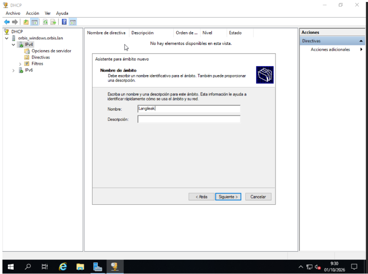

### IP Helbideen Barrutiaren Konfigurazioa (Intervalo de direcciones IP)

Windows Server-eko DHCP zerbitzarian esparru berria (*Ámbito*) sortzen jarraituz, urrats hau burutu dugu:

1. **IP Tartea eta Maskara ezarri ditugu:** Morroiaren urrats honetan, langileen gailuei esleituko zaien IP helbideen tartea definitu dugu:
   - **Hasierako IP-a:** `192.168.10.50`
   - **Amaierako IP-a:** `192.168.10.150`
   - **Luzera eta Azpisare-maskara:** `24` eta `255.255.255.0` (hau da, C klaseko azpisare estandarra).
2. **Helburua:** Tarte honek bermatzen du sarean konektatzen diren bezeroek automatikoki IP helbide bat jasoko dutela `192.168.10.50` eta `192.168.10.150` artean.

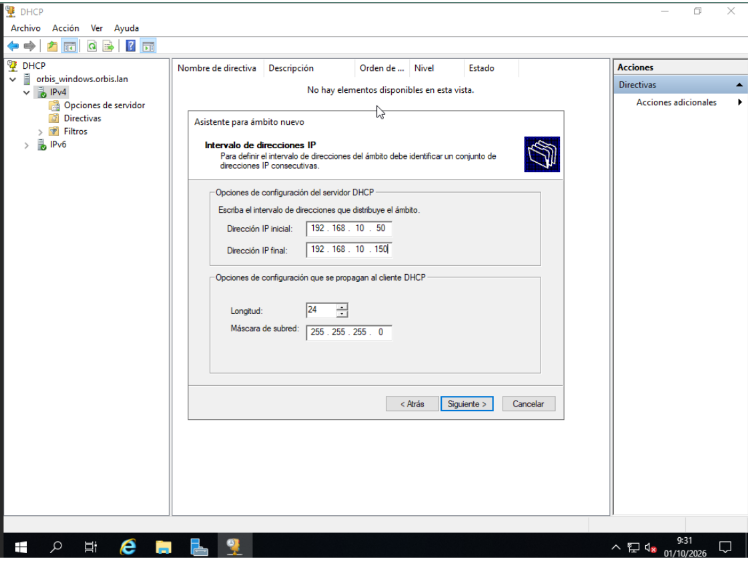

### IP Salbuespenak Konfiguratzea (Agregar exclusiones y retraso)

DHCP esparruaren konfigurazioarekin jarraituz, helbide batzuk banaketatik kanpo uztea erabaki dugu:

1. **IP Salbuespena gehitzea:** Morroiaren urrats honetan, aurretik definitutako tarte orokorren barruan (`192.168.10.50` - `192.168.10.150`), `192.168.10.55` helbidetik `192.168.10.60` helbiderainoko tartea salbuespen gisa erregistratu dugu (*Intervalo de direcciones excluido*).
2. **Helburua:** Tarte honetako IP helbideak ez zaizkie behin ere automatikoki esleituko DHCP bidez konektatzen diren bezeroei. Horri esker, helbide horiek erreserbatuta gelditzen dira IP estatikoa behar duten gailu berezientzat (inprimagailuak, zerbitzariak edo bideratzaileak), gatazkak eta IP bikoiztuak saihesteko.

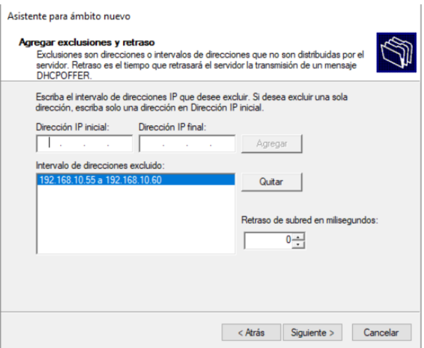

### IP Lagapenaren Denbora-Muga Konfiguratzea (Duración de la concesión)

DHCP esparruaren konfigurazio-morroiarekin aurrera jarraituz, helbide bakoitzaren alokairu-denbora zehaztu dugu:

1. **Concesión edo Lagapen-denbora ezartzea:** Urrats honetan, bezero bati IP helbide bat gordeta mantenduko zaion denbora-muga **30 egunetan** (*Días: 30*) utzi dugu.
2. **Helburua:** Parametro honek definitzen du gailu batek zenbat denboraz erabili ahal izango duen esleitutako IP bera berriztatu gabe. Sare egonkor batean denbora-muga luzeagoa ezartzeak (30 egun adibidez) sareko trafiko alferrikakoa gutxitzen du eta konexioaren jarraitutasuna bermatzen du.

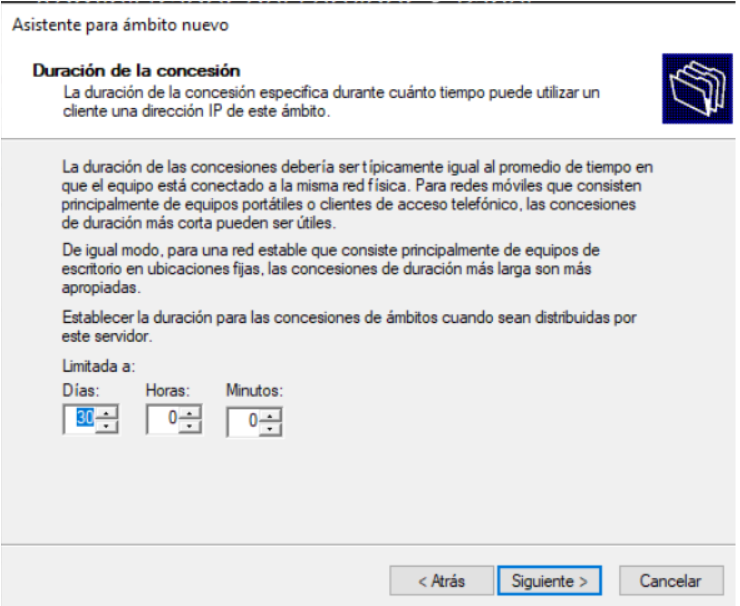

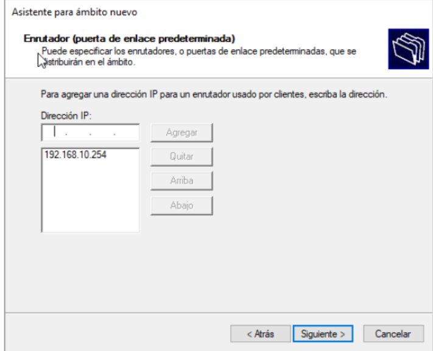

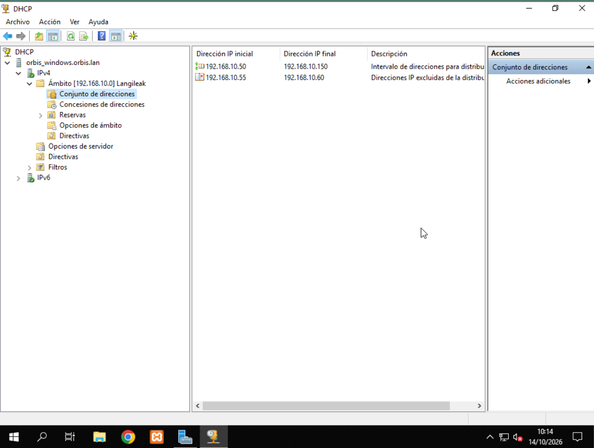

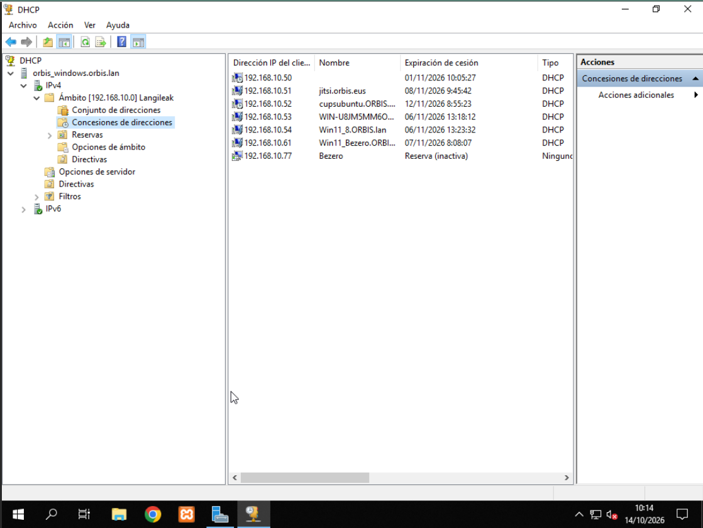

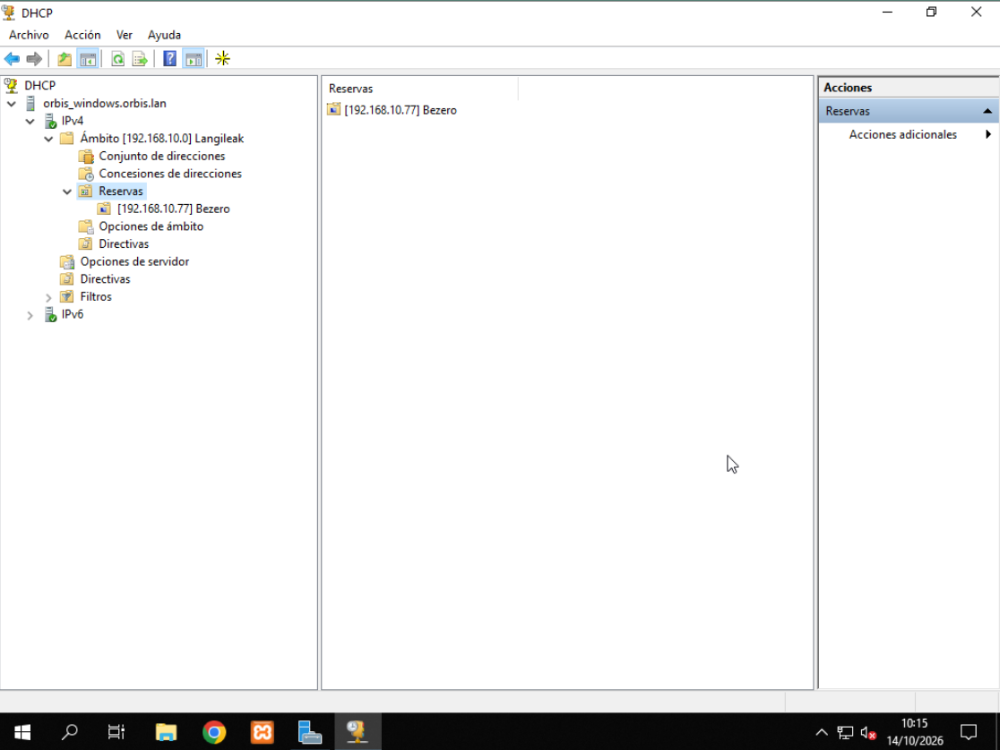

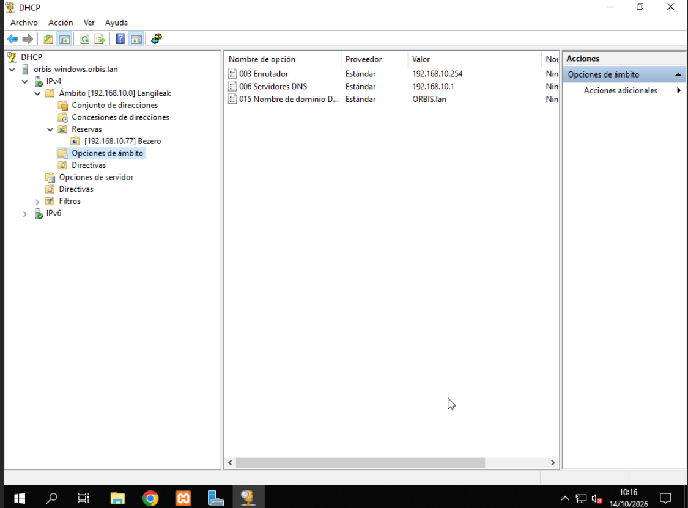

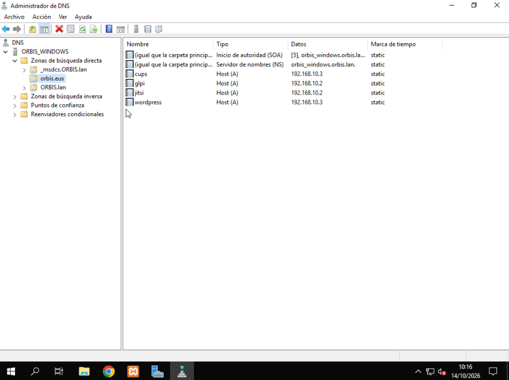

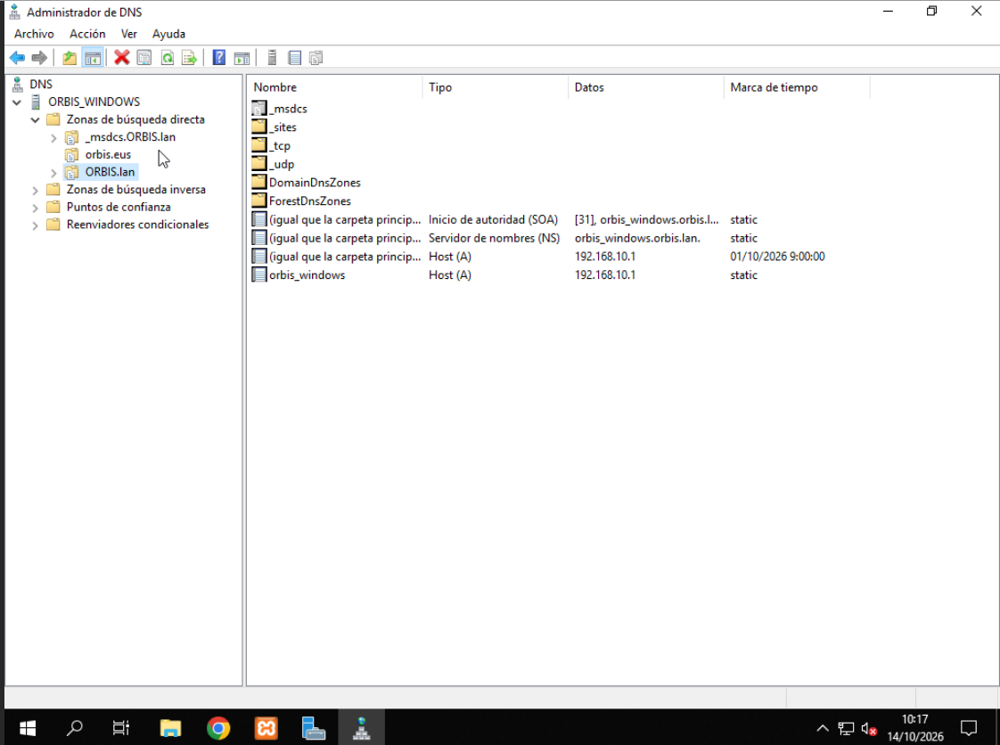

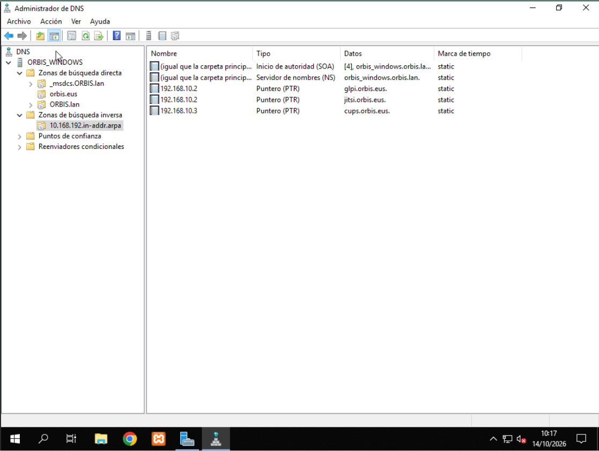

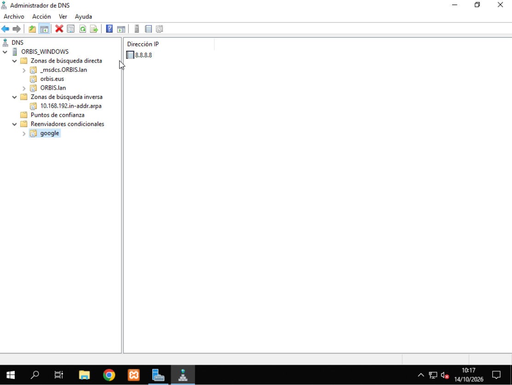

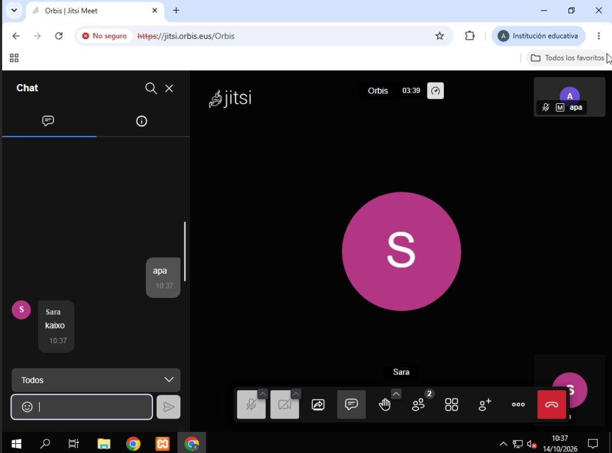
