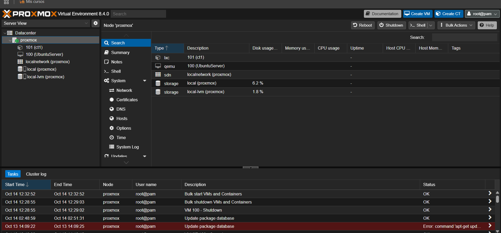
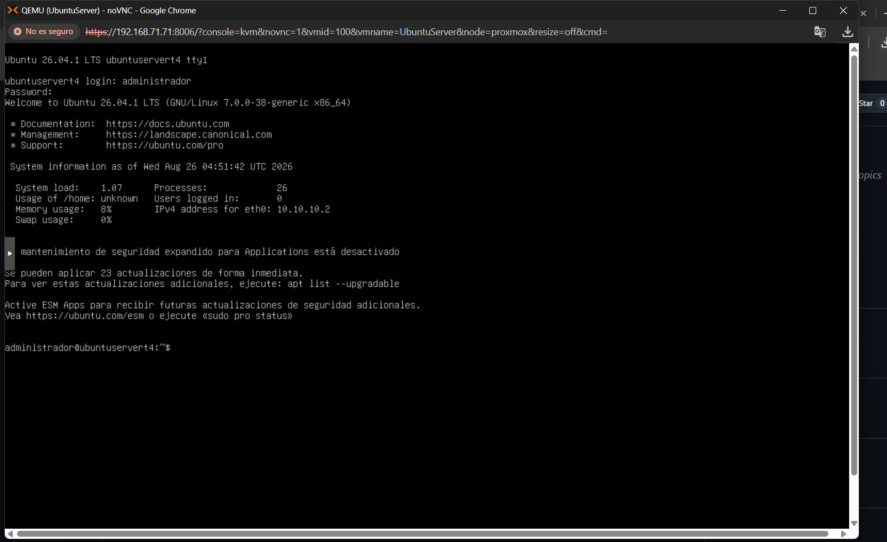
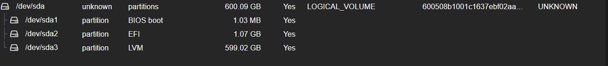

Sistema banatuetan zerbitzari fisiko batean proxmox instalatu dugu 192.168.71.0/24 sarean 192.168.71.71 IP helbidearekin. Zerbitzari fisiko batekin hainbat zerbitzari edukitzeko eta zerbitzari fisikoari ahalik eta etekinik handiena ateratzeko.
Sare bidez konektatuta interfaze grafikoa edukiko genuen

Goiko irudian ikusten den moduan makina birtual bat sortuta dago eta kontenedore bat.
Ondoren ubuntu server bat instalatu 192.168.71.79/24 IP helbidearekin eta ez du zerbitzurik baina martxan dago. Hasieran jitsi eta glpi zerbitzuak edukitzeko zegoen pentsatuta baina azkenean ez dugu zerbitzari horren ubuntu serverra horretarako erabili

Horrez gain hurrengo irudian ikusten den moduan disko bakarra dugu 3 partiziotan

