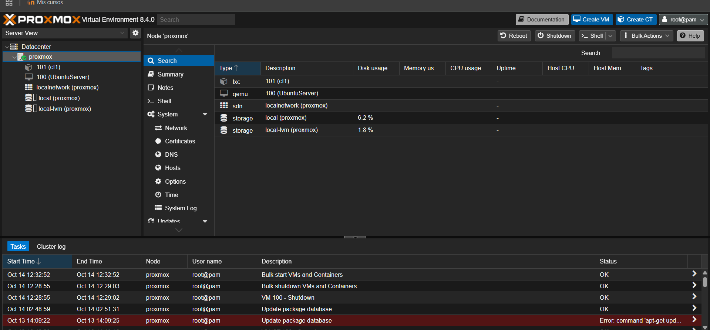
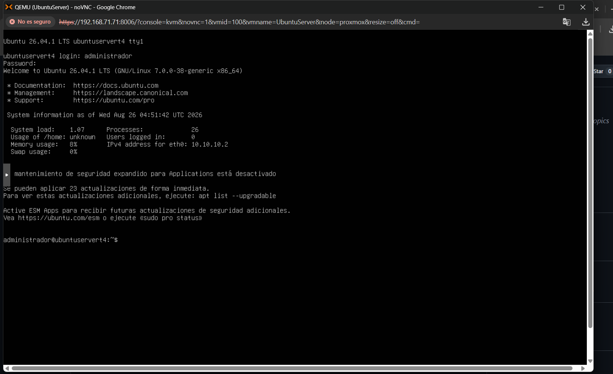

Sistema banatuetan zerbitzari fisiko batean proxmox instalatu dugu 192.168.71.0/24 sarean 192.168.71.71 IP helbidearekin
Sare bidez konektatuta interfaze grafikoa edukiko genuen

Ondoren ubuntu server bat instalatu 192.168.71.75/24 IP helbidearekin eta ez du zerbitzurik baina martxan dago

