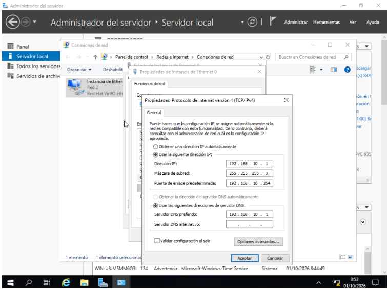
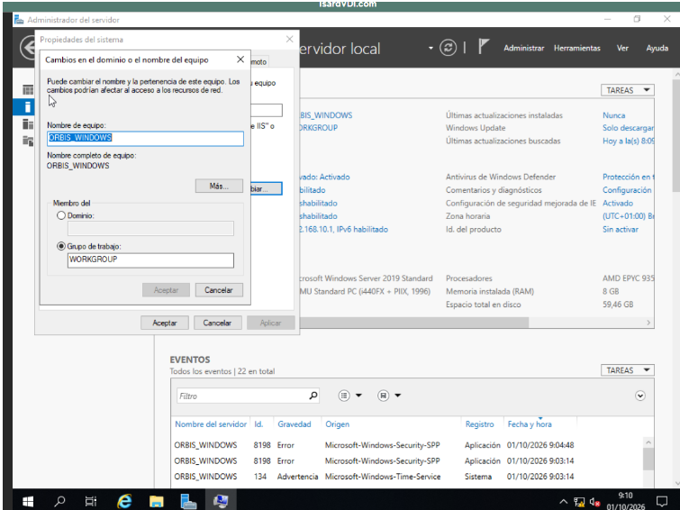
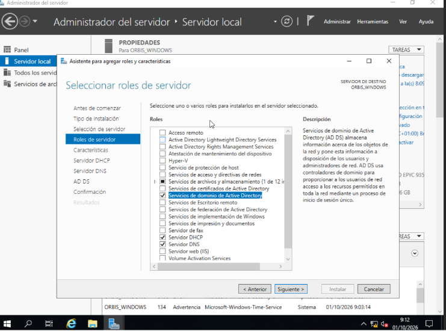
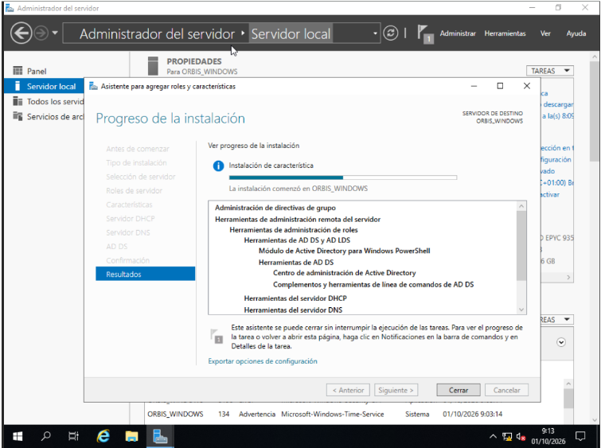
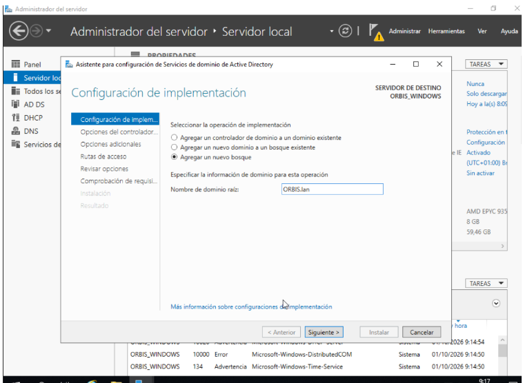
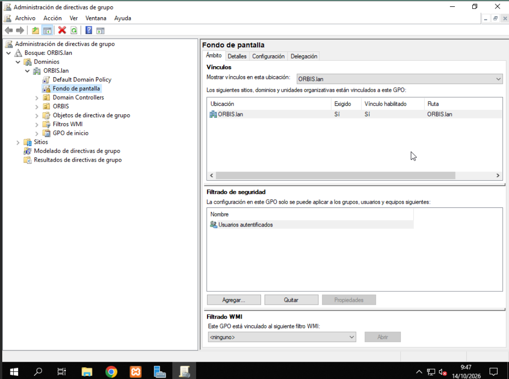
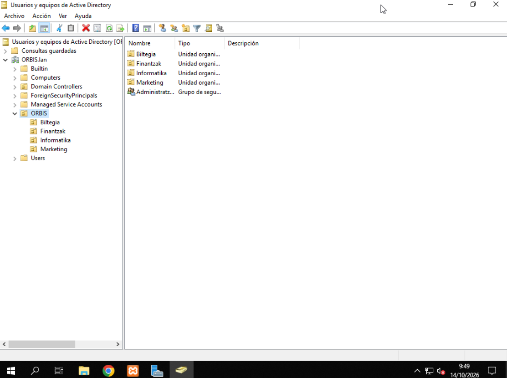
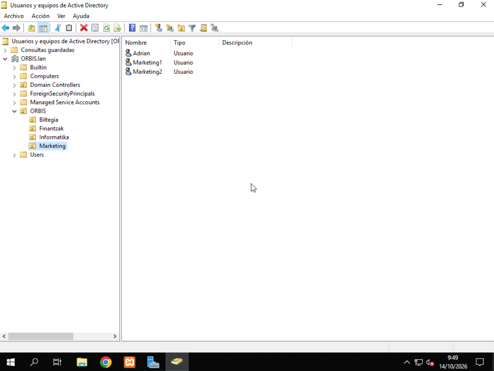
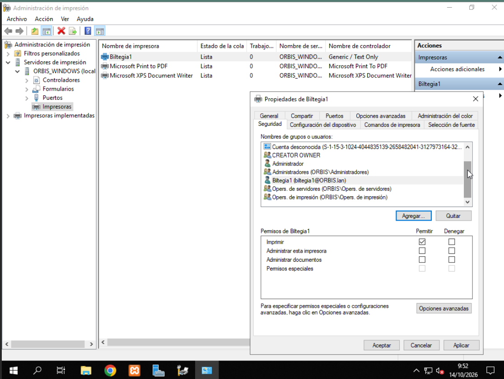
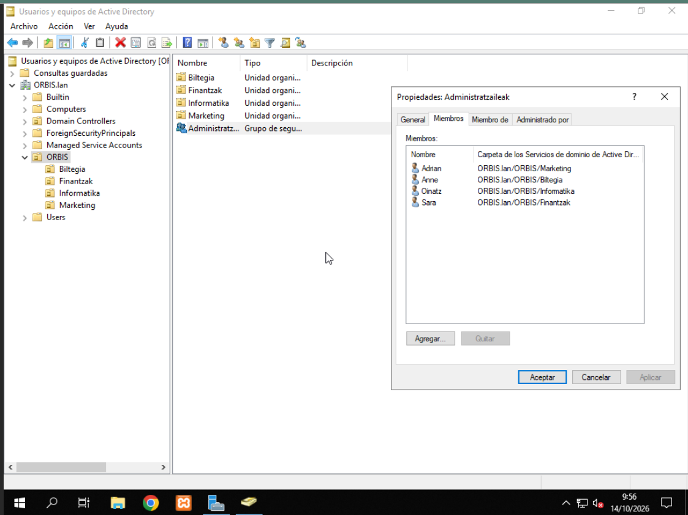

# Sarearen IPv4 Konfigurazioa

Windows Server sisteman, **Ethernet 0** sare-txarteleko IPv4 ezarpenak eskuz konfiguratzen ari gara, IP helbide estatiko bat ezartzeko[cite: 1].

### Konfigurazio datuak:
* **IP helbidea:** `192.168.10.1
* **Azpisare-maskara:** `255.255.255
* **Atebide lehenetsia (Gateway):** `192.168.10.254
* **DNS zerbitzari nagusia:** `192.168.10.1

Zerbitzariari IP finko bat ezartzen ari gatzaizkio sarean beti helbide bera izan dezan.

# Ekiporaren Izena eta Lan-Taldea Konfiguratzea

Windows Server sisteman, zerbitzariaren izena (hostname) eta lan-taldea konfiguratzen ari gara.

### Konfigurazio datuak:
* **Ekiporaren izena:** `ORBIS_WINDOWS
* **Lan-taldea (Grupo de trabajo):** `WORKGROUP

Zerbitzariari izen propio bat ezartzen ari gatzaizkio sarean erraz identifikatu ahal izateko.

# Zerbitzariaren Rolak Hautatzea

Windows Server sisteman, **Rolak eta ezaugarriak gehitzeko laguntzailean** zerbitzarirako hiru rol nagusi hautatzen ari gara:

### Hautatutako rolak:
* **Active Directory domeinu-zerbitzuak (AD DS):** Saren erabiltzaileak, taldeak eta gailuak modu zentralizatuan kudeatzeko
* **DHCP zerbitzaria:** Sarekideei IP helbideak automatikoki esleitzeko.
* **DNS zerbitzaria:** Domeinu-izenak eta IP helbideak elkarren artean ebazteko.

Zerbitzaria gure sareko domeinu-kontrolatzaile nagusi gisa prestatzen ari gara.

# Rol eta Ezaugarrien Instalazioaren Jarraipena

Windows Server sisteman, aurreko urratsean hautatutako rolak, ezaugarriak eta kudeaketa-tresnak instalatzen ari gara `ORBIS_WINDOWS` zerbitzarian.

### Instalatzen ari diren osagai nagusiak:
* **Talde-direktiben kudeaketa (GPO):** Sareko politikak kudeatzeko tresnak.
* **AD DS kudeaketa-tresnak:** Active Directory eta PowerShell moduluak kudeatzeko tresnak.
* **DHCP eta DNS zerbitzarien kudeaketa-tresnak:** Zerbitzu hauek administratzeko lanabesak.

Instalazio-prozesua amaitu arte itxaroten ari gara konfigurazioarekin jarraitu ahal izateko.

# Active Directory Baso Berria Sortzea

Windows Server sisteman, **Active Directory domeinu-zerbitzuak konfiguratzeko laguntzailean** baso berri bat sortzen ari gara.

### Konfigurazio datuak:
* **Inplementazio-eragiketa:** Baso berri bat gehitzea (*Agregar un nuevo bosque*).
* **Erroko domeinu-izena:** `ORBIS.lan`.

Gure Active Directory egitura berrirako lehenengo domeinua eta basoa definitzen ari gara.

# Talde-Direktiba Berria (GPO): Pantaila-Atzealdea

**Talde-direktiben kudeaketan** (*Administración de directivas de grupo*) GPO berri bat konfiguratu eta **`ORBIS.lan`** domeinura estekatu dugu.

### Konfigurazio datuak:
* **GPOren izena:** `Fondo de pantalla`.
* **Estekatutako lekua (Vínculo):** `ORBIS.lan` domeinuan (Nahitaezkoa/Exigido: Bai).
* **Segurtasun-iragazkia:** `Usuarios autenticados` (Autentifikatutako erabiltzaile guztiei ezartzen zaie).

Direktiba honen bidez, domeinuko gailu eta erabiltzaile guztietan atzeko planoko irudia (wallpaper) modu zentralizatuan ezartzea lortzen dugu.

# Active Directoryko Antolaketa Unitateak (OU) Sortzea

**Active Directoryko Erabiltzaile eta Ekipoen** kudeaketan (*Usuarios y equipos de Active Directory*), gure erakundearen egitura antolatzeko **ORBIS** Antolaketa Unitate (OU) nagusia eta sailen araberako azpi-unitateak zein taldeak sortu ditugu.

### Sortutako osagaiak:
* **Antolaketa Unitateak (OU):** `Biltegia`, `Finantzak`, `Informatika` eta `Marketing`.
* **Segurtasun-taldea:** `Administratzaileak' taldea.

Egitura honen bidez, sail bakoitzeko erabiltzaileak, baliabideak eta baimenak modu ordenatu eta zentralizatuan kudeatzea lortzen dugu.

# Marketing Sailan Erabiltzaileak Sortzea

**Active Directoryko Erabiltzaile eta Ekipoen** kudeaketan (*Usuarios y equipos de Active Directory*), **Marketing** Antolaketa Unitatearen (OU) barruan saileko erabiltzaile-kontuak sortu ditugu.

### Sortutako erabiltzaileak:
* **`Adrian`:** Erabiltzaile-kontua (*Usuario*).
* **`Marketing1`:** Erabiltzaile-kontua (*Usuario*).
* **`Marketing2`:** Erabiltzaile-kontua (*Usuario*).

Erabiltzaile hauek Marketing saileko kideei esleitu dizkiegu, domeinuan saioa hasi eta dagozkien baimenekin lan egin dezaten.

